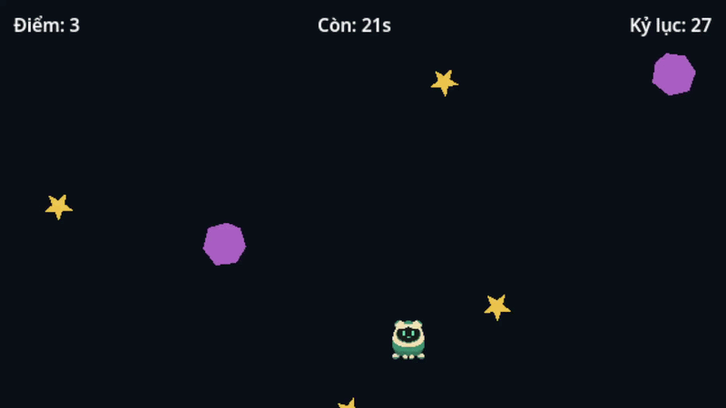

# Athena và Đêm Sao — project thực hành Godot 101



Project Demo cơ bản về godot trong 10 phút. 

## Cách Chạy

Tải toàn bộ project về file ZIP. Giải nén ZIP, chọn **Import → project.godot** trong Godot, đợi import ảnh/âm thanh,
rồi F5. 

## Hướng dẫn

Đọc toàn bộ hướng dẫn đầy đủ cho game trên [Aiducation](https://www.aiducation.edu.vn)

## Đọc mã theo chương

| Chương | File / việc thực hành |
| --- | --- |
| 1–2 | `project.godot`, `main.tscn`, `athena.tscn`: cửa sổ 640×360, scene và node con |
| 3–4 | `athena.gd`: biến, hàm, Input Map, velocity, move_and_slide |
| 5–6 | `main.gd`: `_tao_vat`, instantiate, nối hai custom signal |
| 7 | `vat_roi.gd`, hai scene vật rơi: Area2D nhận CharacterBody2D qua body_entered |
| 8 | Ba Timer trong Main; vật ra khỏi màn hình tự queue_free |
| 9 | `main.gd`: enum, điểm, thời gian, bảo vệ callback sau kết thúc |
| 10 | `HUD/GiaoDien`: anchors, MarginContainer, HBoxContainer, Label |
| 11 | `bat_dau`, `ket_thuc`: menu, kết quả và chơi lại trong cùng một scene |
| 12 | AnimationPlayer trong Athena; AudioStreamPlayer sống ở Main |
| 13 | ConfigFile, thông báo lỗi lưu, export Web bằng Compatibility |


## Cấu trúc

```
Main (Node2D, main.gd)
├── Athena (instance athena.tscn, CharacterBody2D)
│   ├── Sprite2D
│   ├── CollisionShape2D
│   └── AnimationPlayer
├── VatThe (Node2D; sao và bóng được thêm lúc chạy)
├── SinhSao / SinhBong / DongHo (Timer, Autostart tắt)
├── AmNhat (AudioStreamPlayer)
└── HUD (CanvasLayer)
	└── GiaoDien (Control, Full Rect)
		├── Le (MarginContainer) → ThongSo (HBoxContainer) → Diem / ThoiGian / KyLuc
		└── Menu (CenterContainer) → Cot (VBoxContainer) → TieuDe / HuongDan / Choi
```

## Hãy tự chỉnh theo mong muốn của bạn

Thêm các loại sao cho nhiều điểm hơn, thay đổi hình dạng nhân vật, tăng tốc độ di chuyển, hãy tự do khám phá demo này!

